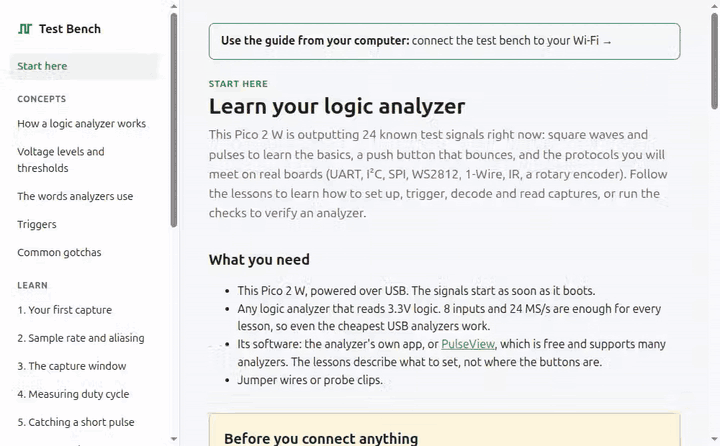
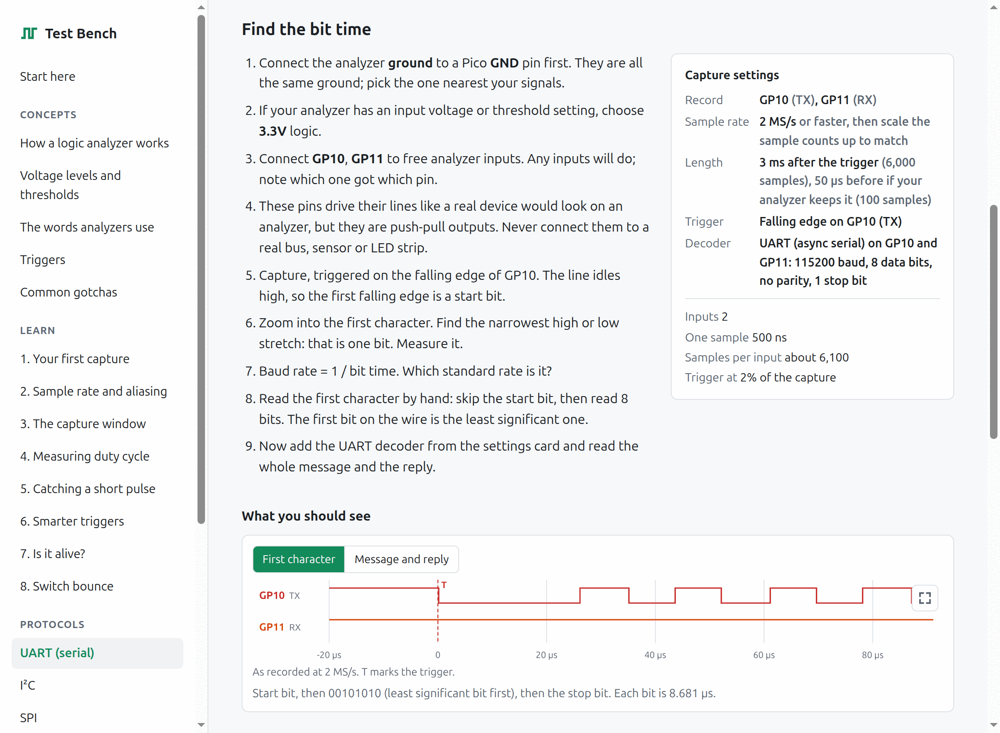
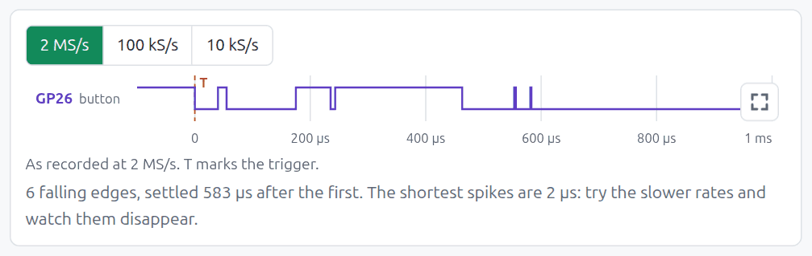
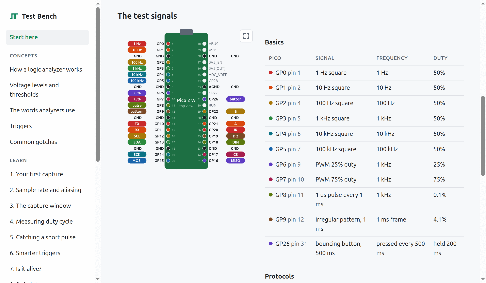
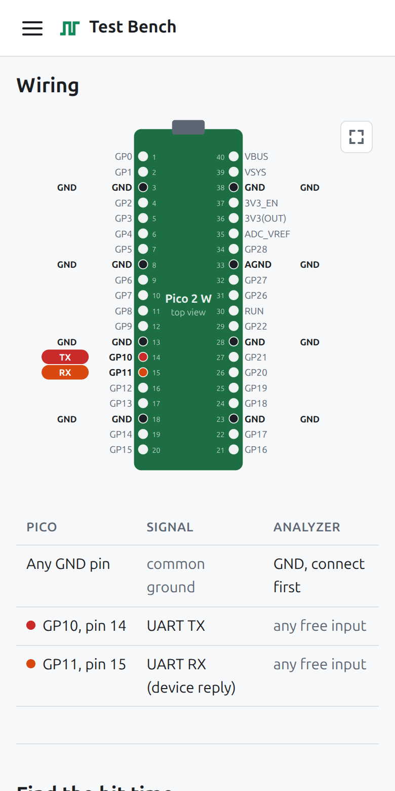

# Logic Analyzer Test Bench

**Learn to use a logic analyzer on signals you already know the answer to.**

A logic analyzer is easy to plug in and hard to trust at first: is that glitch real, or is the sample rate too low? Is the decoder wrong, or the wiring? This project turns a **Raspberry Pi Pico 2 W** into a practice board that answers those questions. It outputs 24 known 3.3V test signals and carries its own guided lessons, served over Wi-Fi to your phone or computer. Each lesson tells you what to connect, how to set up the capture and the trigger, and shows the capture you should get, so you can compare and find out where yours differs.

It works with **any logic analyzer and any software**: the analyzer's own app, or the free [PulseView](https://sigrok.org/wiki/PulseView). The lessons describe what to set, not where to click.

> **No building, no tools, no install.** Everything is in one firmware file: the 24 signals, the Wi-Fi hotspot and the complete guide. [Download `logic_test_bench.uf2`](https://github.com/wazp/logicAnalyzerTestBench/releases/latest/download/logic_test_bench.uf2) (always the newest version), drag it onto the Pico 2 W, and you are done. You never need the build instructions further down unless you want to change the firmware.

## What the guide looks like



Each lesson tells you which pins to connect, what to set on the analyzer, and shows the capture you should get, computed from the firmware's own configuration:



Drawings can show what a slower capture would record. Here the bouncing button at 2 MS/s, 100 kS/s and 10 kS/s: the short spikes vanish as the sample rate drops.



The home page shows every signal on the pinout, with its frequency and duty cycle:



On the hotspot the guide runs on your phone, so it can sit next to the analyzer:



## What you learn

| Track | Lessons |
|---|---|
| Concepts | How a logic analyzer works, voltage levels and thresholds (3.3V, 5V, VREF), the words analyzers use, triggers, common gotchas, what a logic analyzer can't show you, memory depth and long captures |
| Learn | First capture, sample rate and aliasing, the capture window, measuring duty cycle, catching a short pulse, smarter triggers, checking whether a board is alive, switch bounce, identifying an unknown signal, timing between two signals, finding one event in a long recording, exporting and scripting |
| Protocols | UART, I²C, SPI, WS2812 LEDs, 1-Wire, IR remote (NEC), quadrature encoder, what wrong decoder settings look like, and (optional) stacked sigrok decoders |
| Video and input | VGA video timing, an NES controller, a PS/2 keyboard (with the Video and input preset) |
| Find the bug | UART with a slow sender, a framing and a parity error; I²C clock stretching and a refused write; SPI cut short and in the wrong mode; a marginal WS2812 bit; 1-Wire with no device and a bad CRC; glitch hunting (with the Faults preset) |
| Verify | Sanity check of every analyzer input with a pass/fail checklist, clock accuracy in ppm, every input and the skew between them, and how fast your analyzer really goes (with the Verify preset) |

Every lesson needs at most **8 inputs** and **24 MS/s**, so even the cheapest USB analyzers can follow all of them. Signals are named by Pico pin (GP0, GP10...) rather than analyzer channel, and every expected waveform in the guide is computed from the same configuration the firmware uses, so the guide and the board can't disagree.

## What you need

- A **Raspberry Pi Pico 2 W** and a USB cable. The original Pico and Pico W are not supported.
- A few jumper wires.
- **Any logic analyzer** that reads 3.3V logic, with at least 8 inputs and 24 MS/s.
- A phone or computer with a browser, to read the guide.

Looking for an analyzer? The [gusmanb LogicAnalyzer](https://github.com/gusmanb/logicanalyzer) is an excellent open-source one: 24 channels, built around a Raspberry Pi Pico, with its own desktop app. It is the analyzer this test bench was developed and tested with.

## Quick start

1. [Download `logic_test_bench.uf2`](https://github.com/wazp/logicAnalyzerTestBench/releases/latest/download/logic_test_bench.uf2). Hold the Pico's **BOOTSEL** button while you plug it into USB, then drag the file onto the `RP2350` drive that appears. The board restarts and the signals start right away (details in [Flashing](#flashing)).
2. Join the Wi-Fi network **`TestBench-XXXX`** (password **`testbench`**). The guide opens as a sign-in page.
3. Optional: in the guide's Wi-Fi settings, let the test bench join your own network, so you can read the lessons on the computer that runs your analyzer software.
4. Connect ground, then follow the first lesson.

## How it works

All signals are generated in hardware (PIO, PWM and DMA). Once started, the CPU only runs the USB serial console and the Wi-Fi web server, so the signals have no software jitter. The basic signals cover square waves, PWM and pulses (sample rates, triggers, measuring); GP10 to GP22 carry the protocols you meet on real boards, or, with another [signal preset](#signal-presets), a VGA picture, an NES controller and a PS/2 keyboard, or the same buses with realistic mistakes to find. GP26 is a push button that bounces like a real one. Every protocol simulates both sides of its bus, so nothing else needs to be connected.

The guide is a small web app built into the firmware. It needs no internet connection, no app install and no account. All you need is the Pico and this firmware.

Built with the official [Raspberry Pi Pico SDK](https://github.com/raspberrypi/pico-sdk) (2.3.1) and CMake.

## Signals

### Basic signals

| GPIO | Physical pin | Signal (default) | Generated by |
|---|---|---|---|
| GP0 | 1 | 1 Hz square wave, 50% | PIO0 SM0 |
| GP1 | 2 | 10 Hz square wave, 50% | PIO0 SM1 |
| GP2 | 4 | 100 Hz square wave, 50% | PIO0 SM2 |
| GP3 | 5 | 1 kHz square wave, 50% | PIO0 SM3 |
| GP4 | 6 | 10 kHz square wave, 50% | PIO1 SM0 |
| GP5 | 7 | 100 kHz square wave, 50% | PIO1 SM1 |
| GP6 | 9 | 1 kHz PWM, 25% duty | PWM slice 3 A |
| GP7 | 10 | 1 kHz PWM, 75% duty | PWM slice 3 B |
| GP8 | 11 | 1 us high pulse every 1 ms | PWM slice 4 A |
| GP9 | 12 | Irregular repeating pattern, 1 ms period | PIO1 SM2 + DMA |
| GND | 3, 8, 13, 18, 23, 28, 33 (AGND), 38 | Ground, all the same | |

All square waves, the GP9 pattern, the protocol frame and the GP26 button start on the same clock cycle, so their rising edges line up (every 1 Hz edge coincides with a 10 Hz edge, and so on). The PWM outputs start a few cycles apart from the PIO outputs.

### The GP9 pattern

One 1 ms frame, then it repeats:

```
 10us H | 5us L | 20us H | 2us L | 1us H | 1us L | 1us H | 50us L | 3us H | 3us L | 3us H | 3us L | 3us H | 895us L
```

The 10 us pulse is a frame marker. Try setting your analyzer to trigger on a "pulse wider than 8 us" and measure the rest.

### Protocol signals

With the **Protocols** preset (the default, see [Signal presets](#signal-presets)), GP10 to GP22 carry protocol traffic. All of it repeats in one **120 ms frame**, played by a single PIO state machine from a timeline computed at boot (see [docs/timing.md](docs/timing.md)). Every protocol simulates **both sides** of its bus (the sensor's ACKs, the flash chip's answer, the device's UART reply), so nothing else needs to be connected.

| GPIO | Physical pin | Signal | What it carries |
|---|---|---|---|
| GP10 | 14 | UART TX | 115200 baud 8N1: `Test bench #1\r\n` to `#4`, one every 30 ms |
| GP11 | 15 | UART RX | The simulated device answers `OK\r\n` 1 ms after each message |
| GP12 | 16 | I²C SCL | 100 kHz |
| GP13 | 17 | I²C SDA | Every 10 ms: register read from a TMP102-style sensor at 0x48 (25.0 °C). Once per frame: address 0x49, NAK |
| GP14 | 19 | SPI SCK | 1 MHz, mode 0 |
| GP15 | 20 | SPI MOSI | Every 10 ms: JEDEC ID command 0x9F |
| GP16 | 21 | SPI MISO | The simulated flash answers EF 40 18 (Winbond W25Q128) |
| GP17 | 22 | SPI CS | Active low, frames each transfer |
| GP18 | 24 | WS2812 data | 8 LEDs, a moving rainbow, updated every 10 ms |
| GP19 | 25 | 1-Wire | DS18B20: Convert T at 5 ms, Read Scratchpad at 65 ms (25.0625 °C, valid CRC) |
| GP20 | 26 | IR remote | NEC as an IR receiver outputs it (active low): address 0x00, command 0x45, then a repeat code |
| GP21 | 27 | Quadrature A | Rotary encoder: 60 steps forward, then 60 back, 1 ms per step |
| GP22 | 29 | Quadrature B | |

> **Do not connect the protocol pins to real devices.** I²C and 1-Wire are open-drain buses on real hardware; here every line is driven push-pull. That looks identical to a logic analyzer, but a real sensor, LED strip or bus on these pins could be damaged.

### Signal presets

GP10 to GP22 play one **preset** at a time. GP0 to GP9 and the GP26 button never change.

| Preset | GP10 to GP22 |
|---|---|
| **Protocols** (default) | UART, I²C, SPI, WS2812, 1-Wire, IR remote and a quadrature encoder, as listed above |
| **Video and input** | A VGA picture, an NES controller and a PS/2 keyboard, listed below |
| **Faults** | The protocol buses with realistic mistakes to find, each next to a good transaction, and an interrupt line with glitches, listed below |
| **Verify** | A 12-bit binary counter and frequency bursts up to 25 MHz, for checking an analyzer, listed below |

To switch, use any of these:

- **Settings > Signal preset** in the guide. Lessons that need the other preset also show a **Switch** button at the top.
- Press `p` on the [serial console](#usb-serial-console), then the preset's number.
- `POST /api/preset` with the form field `preset=protocols`, `preset=video`, `preset=faults` or `preset=verify`.

Switching saves the preset and restarts the board, which takes a few seconds, so every signal starts in step again. The board remembers the preset when unplugged, and a saved Wi-Fi network is kept. On the setup hotspot, your phone may need to rejoin `TestBench-XXXX` after the restart.

#### Video and input preset

| GPIO | Physical pin | Signal | What it carries |
|---|---|---|---|
| GP10 | 14 | VGA HSYNC | 640x480, active low: 3.84 µs pulse every 32 µs (31.25 kHz) |
| GP11 | 15 | VGA VSYNC | Active low: 2 lines (64 µs) every 16.8 ms (59.52 Hz) |
| GP12 | 16 | VGA red | Eight color bars: white, yellow, cyan, green, magenta, red, blue, black |
| GP13 | 17 | VGA green | 25 MHz pixels (40 ns), each bar 80 pixels wide |
| GP14 | 19 | VGA blue | Dark during blanking, as monitors expect |
| GP15 | 20 | NES latch | Once per video frame, at the start of vertical blanking: 12 µs pulse |
| GP16 | 21 | NES clock | 8 low pulses, 12 µs apart |
| GP17 | 22 | NES data | The simulated controller: A + Right pressed, then Start in the next frame (low = pressed) |
| GP18 | 24 | PS/2 clock | Keyboard clock, 12.5 kHz while sending |
| GP19 | 25 | PS/2 data | The A key: make code 0x1C, then 0xF0 0x1C when released one frame later |
| GP20-GP22 | 26, 27, 29 | (none) | Held low in this preset |

The VGA pins can drive a real monitor, the one place on the test bench meant for a real device: connect GP12, GP13 and GP14 through 270 Ω resistors to VGA pins 1, 2 and 3, GP10 to pin 13, GP11 to pin 14, and GND to pins 5 to 8 and 10. The pixel clock is 25 MHz rather than the standard 25.175 MHz, which monitors accept. Never connect these pins to a VGA output.

#### Faults preset

The buses sit on the same pins as in the Protocols preset, so the wiring of the protocol lessons still works. Every fault repeats once per 120 ms frame, next to a good transaction to compare with.

| GPIO | Physical pin | Signal | What goes wrong |
|---|---|---|---|
| GP10 | 14 | UART TX, 115200 8N1 | A good message, the same from a sender 3% slow (111,744 baud), and one with a framing error (a low stop bit) |
| GP11 | 15 | UART TX, 115200 8E1 | A reading sent twice; the second has a parity error |
| GP12 | 16 | I²C SCL | A read during which the sensor stretches the clock by 150 µs |
| GP13 | 17 | I²C SDA | A write whose data byte the sensor refuses (NAK) |
| GP14-GP17 | 19-22 | SPI SCK, MOSI, MISO, CS | A transfer aborted after 12 bits (CS rises mid-byte) and retried, and one answered by a device in SPI mode 1 |
| GP18 | 24 | WS2812 data | 8 LEDs in dim white; one bit of LED 5 is 550 ns high, between a 0 and a 1 |
| GP19 | 25 | 1-Wire | A reset nobody answers (no presence pulse), then a scratchpad read with a bad CRC |
| GP20 | 26 | Interrupt line, active low | Two real 10 µs pulses, and glitches of 20, 40 and 100 ns at irregular times |
| GP21-GP22 | 27, 29 | (none) | Held low in this preset |

#### Verify preset

| GPIO | Physical pin | Signal | What it carries |
|---|---|---|---|
| GP10-GP21 | 14-27 | Counter bits 0 to 11 | A 12-bit binary counter, one count every 2 µs: GP10 is 250 kHz, each pin after it half the frequency of the one before. All bits that change together change in the same PIO instruction, so they are a test for skew between analyzer inputs. One full count is 8.192 ms. |
| GP22 | 29 | Frequency bursts | 16 periods each of 25, 18.75, 15, 12.5, 7.5, 5, 2.5 and 1 MHz, once per count, to find where an analyzer stops keeping up |

### The GP26 bouncing button

GP26 (physical pin 31) behaves like a push button with a pull-up: high when released, low when pressed. It is pressed every 500 ms and held for 200 ms, and its contacts bounce on both press and release, the way a real button's do:

```
 press:   40us L | 15us H | 120us L | 60us H | 8us L | 220us H | 90us L | 3us H | 25us L | 2us H | held low
 release: 20us H | 6us L | 70us H | 4us L | released high for the rest of the 500 ms
```

That is 6 falling edges for one press, and 2 more on release. It is played by PIO2 SM0 with the same pattern player as GP9. GP27 and GP28 are still free.

### Changing the signals

Edit [src/signal_config.h](src/signal_config.h). Frequencies, duty cycles, the pulse width, the pattern segments and every protocol setting (baud rates, messages, addresses, timing) are all plain values there. This needs [building from source](#building-from-source-optional). After rebuilding, the actual generated values (after rounding to whole clock cycles) are shown on the serial console. See [docs/timing.md](docs/timing.md) for what is achievable.

## The web guide

1. Power the Pico 2 W. The onboard LED lights up when the guide is available (a few seconds after boot).
2. Join the Wi-Fi network **`TestBench-XXXX`** (the last four characters are unique per board). Password: **`testbench`**.
3. The phone or laptop treats the network as a sign-in page (like hotel Wi-Fi) and shows the guide. On Android, tap **Sign in to Wi-Fi network** if the guide does not open by itself. You can also browse to **http://4.3.2.1/**.

On the hotspot, the guide opens on its Wi-Fi page first, since joining your own network is usually the first thing to do. **Start here** in the menu takes you to the lessons.

The hotspot has no internet access; it only serves the guide. The guide works in any modern browser, phones included. The network name and the address are also printed on the serial console.

The address is `4.3.2.1` rather than the usual `192.168.x.x` on purpose. Recent Android versions decide a network has "no internet" when their connectivity check resolves to a private address. They then skip the sign-in page and keep browsers off the network. Tested on a Samsung Galaxy S24 (Android 17).

### Connecting the test bench to your Wi-Fi

To read the guide on the computer that runs the analyzer app, without losing that computer's internet connection, let the test bench join your own network:

1. Join the `TestBench-XXXX` hotspot as above and open **Settings > Wi-Fi** in the guide.
2. Press **Scan for networks**, pick yours and enter its password (or **Enter a name** for a hidden network). Press **Join**.
3. The test bench saves the network and restarts. Connect your device back to your own network and open **http://testbench-xxxx.local/**, with the same four characters as the hotspot name. The page shows the exact address before it restarts.

From then on the test bench joins that network at every boot and its own hotspot stays off. If the `.local` name does not open (some older Windows and Android versions do not support it), use the IP address instead: press `w` on the serial console, or look for `testbench-xxxx` in your router's list of devices.

If the network can't be joined at boot (wrong password, out of range, router off), the `TestBench-XXXX` hotspot comes back after about 20 seconds and the Wi-Fi page says what went wrong. If the link drops later, the test bench keeps trying to rejoin.

To forget the network and go back to the hotspot, use any of these:

- **Forget** on the guide's Wi-Fi page.
- Press `f`, then `y`, on the serial console.
- While the board is running, hold the **BOOTSEL** button until the LED goes off (3 seconds), then release it. No computer needed. (It restarts only after you let go: holding BOOTSEL during a restart would put the Pico in flashing mode instead.)

The test signals keep running through all of this. Joining, scanning and saving settings never stop or disturb them.

Security: the saved password is stored in plain text in the Pico's flash, and anyone who can open the guide (on the hotspot or your network) can change or forget the network. The guide never shows the saved password. This is meant for a workbench, not for a network you need to protect from the people near it.

## Wiring

Any logic analyzer that reads 3.3V logic works. Connect ground first, then the signals each lesson asks for to any free inputs:

```
 Pico 2 W                      Logic analyzer
 ---------                     --------------
 GND (any GND pin) ----------- GND            <- always connect ground first
 GP0 (pin 1)  ---------------- any input
 GP1 (pin 2)  ---------------- any input
 ...
```

- If your analyzer has an input voltage or threshold setting, choose 3.3V logic.
- Power the Pico from USB. The analyzer and Pico must share ground.
- Physical pin numbers count from pin 1 (top left, next to the USB connector, with the board seen from above) down the left side. GPIO numbers are not the same as physical pin numbers.
- Name each input after its Pico pin in your software (`GP0`, `GP10`...), so captures match the guide.
- With 24 or more inputs you can wire everything at once, for example GPn to input n. With 8, rewire per lesson; no lesson needs more.

### Electrical safety

- Every output is a 3.3V push-pull GPIO. Nothing on this board drives above 3.3V.
- Only connect the signal pins to **inputs** (analyzer probes, scope probes). Never connect them to another output, to 5V, or directly to ground.
- Do not use GP23, GP24, GP25 or GP29. On the Pico 2 W these are wired to the CYW43439 wireless chip, which runs the Wi-Fi guide. The firmware refuses to build if a signal is assigned to them.
- Default drive strength is 4 mA. That is plenty for analyzer inputs, which draw almost nothing.
- During development the board does not need to be connected to anything. It runs fine with nothing attached to the GPIOs.

## Flashing

### Drag and drop (no extra tools)

Works the same on Windows, macOS and Linux.

1. [Download `logic_test_bench.uf2`](https://github.com/wazp/logicAnalyzerTestBench/releases/latest/download/logic_test_bench.uf2), the newest version (or build it yourself, see below). The [release page](https://github.com/wazp/logicAnalyzerTestBench/releases/latest) has the release notes and the network debug build.
2. Unplug the Pico 2 W.
3. Hold the **BOOTSEL** button and plug in USB. Release the button.
4. A drive called `RP2350` appears. Drag `logic_test_bench.uf2` onto it.

The board reboots and starts generating signals immediately. Updating later is the same: flash the new `.uf2` the same way. Your saved Wi-Fi network is kept.

From a Linux terminal, step 4 is:

```bash
cp ~/Downloads/logic_test_bench.uf2 /media/$USER/RP2350/
```

### With picotool (optional)

For people building from source. The picotool built by the SDK has no USB support. To flash over USB without pressing BOOTSEL, build picotool yourself with libusb (see the [picotool README](https://github.com/raspberrypi/picotool)), install its udev rules, then:

```bash
picotool load -x -f build/logic_test_bench.uf2
```

### Flash layout

The firmware uses about 0.5 MB of the 4 MB flash. The **second-to-last 4 KB sector** holds the saved Wi-Fi network and the signal preset; flashing a new `.uf2` keeps them, so you don't need to set up Wi-Fi again after an update. (Not the last sector: every RP2350 `.uf2` includes a workaround block for boot ROM erratum RP2350-E10 that lands there and erases it.) The firmware refuses to start if it ever grows into the settings sector.

## Building from source (optional)

Only needed if you want to change the firmware, for example the signals in [src/signal_config.h](src/signal_config.h). The release `.uf2` already contains everything. Every push is also built by CI, which keeps the firmware `.uf2` files as downloadable artifacts of the run.

The instructions are for Ubuntu Linux (tested on 24.04).

### 1. Install the toolchain (once)

```bash
sudo apt install cmake ninja-build gcc-arm-none-eabi libnewlib-arm-none-eabi libstdc++-arm-none-eabi-newlib libusb-1.0-0-dev build-essential git python3
```

The web guide also needs **Node.js 20 or newer** with npm (for example from [nodejs.org](https://nodejs.org/) or `nvm`). Ubuntu's own `nodejs` package may be too old.

### 2. Get the Pico SDK (once)

```bash
mkdir -p ~/pico && git clone --branch 2.3.1 --depth 1 https://github.com/raspberrypi/pico-sdk.git ~/pico/pico-sdk && git -C ~/pico/pico-sdk submodule update --init --depth 1
```

Add this to your `~/.bashrc` so CMake can find it:

```bash
export PICO_SDK_PATH=~/pico/pico-sdk
```

### 3. Build

```bash
cmake -S . -B build -G Ninja
```

```bash
cmake --build build
```

The output is `build/logic_test_bench.uf2` (plus `.elf`, `.bin`, `.hex`). The first build also compiles `picotool` and `pioasm` from source and installs the web guide's npm packages, which takes a minute.

The firmware build runs `npm run build` in `web/` and embeds the result, so the guide is always up to date with the firmware. To build without Node.js, build the web guide elsewhere, copy `web/dist/index.html` into place and configure with `-DLTB_BUILD_WEB=OFF`.

The board is set to `pico2_w` in [CMakeLists.txt](CMakeLists.txt). This firmware does not support the original Pico or Pico W (RP2040).

## USB serial console

The board shows up as a USB CDC serial port, usually `/dev/ttyACM0`. Your user needs to be in the `dialout` group (`sudo usermod -aG dialout $USER`, then log out and back in).

```bash
tio /dev/ttyACM0
```

(`screen /dev/ttyACM0 115200` works too. The baud rate is ignored for USB serial, except that opening the port at **1200 baud** reboots the Pico into BOOTSEL mode, ready for a new `.uf2`. That is handy for flashing without pressing the button: `stty -F /dev/ttyACM0 1200`.)

When the terminal connects, the board prints a banner with the Wi-Fi details, the signal preset and a status table showing, for each pin, the requested and the actual frequency, duty cycle and peripheral. Commands:

| Key | Action |
|---|---|
| `s` | Print the status table |
| `w` | Print the Wi-Fi status: hotspot or joined network, IP address and guide address |
| `p` | List the signal presets, then press a preset's number to switch to it (the board restarts) |
| `f` | Forget the saved Wi-Fi network (asks for `y` to confirm) and restart into the hotspot |
| `h` | Print help |

The firmware never waits for a terminal. Signals run whether or not a host is connected.

## Running the unit tests

The timing math (cycle counts, PWM dividers, pattern encoding) is plain C++ in `src/core/` and is tested on your PC, no board or SDK required:

```bash
cmake -S tests -B build-tests && cmake --build build-tests && ctest --test-dir build-tests --output-on-failure
```

The tests also check the shipped defaults: every default must be valid, exact at 150 MHz, and free of pin or state machine conflicts. They also check that `web/src/data/signals.json` (the signal data the guide uses) matches the C++ config.

The web guide has its own tests (signal drawing, analyzer limits, and that every lesson's settings are accepted by the analyzer):

```bash
npm --prefix web test
```

## Working on the web guide

The guide is a small [Preact](https://preactjs.com/) + TypeScript app in `web/`, built by Vite into a single `index.html` with everything inlined (about 90 KB gzipped).

```bash
npm --prefix web ci
```

```bash
npm --prefix web run dev
```

That serves the guide at http://localhost:5173 with live reload, no board needed. The dev server also fakes the test bench's API (`web/dev/mockDevice.ts`), so the Wi-Fi and preset pages work too. Start it with `MOCK_MODE=joined`, `error` or `none` to see the other states, and `MOCK_PRESET=video` to start in the other preset. Lessons are data, one file per lesson in `web/src/lessons/` (`concepts/`, `basics/`, `protocols/`, `video/`, `verify/`), listed in guide order in `web/src/lessons/index.ts`. The limits every lesson must stay within (8 inputs, 24 MS/s) live in `web/src/model/capture.ts`.

When you change `src/signal_config.h`, regenerate the guide's signal data (the host tests fail until you do):

```bash
./build-tests/export_signals web/src/data/signals.json
```

```bash
./build-tests/export_protocols web/src/data/protocols.json
```

```bash
./build-tests/export_video web/src/data/video.json
```

### Debugging the Wi-Fi guide

If a phone joins but the guide does not appear, build with network logging. The firmware then prints every DNS query, TCP connection attempt and HTTP request on the serial console:

```bash
cmake -S . -B build-debug -G Ninja -DLTB_NET_DEBUG=ON
```

```bash
cmake --build build-debug
```

Flash `build-debug/logic_test_bench.uf2`. The Wi-Fi line in the console banner ends with "(network debug logging on)" when the debug build is running.

## Timing and limitations

Short version: frequencies are exact multiples of the 150 MHz system clock, so accuracy equals the crystal accuracy (tens of ppm) and there is no jitter. Values that do not divide 150 MHz evenly are rounded to the nearest clock cycle and the console shows the real value. Details, ranges and recommended analyzer sample rates are in [docs/timing.md](docs/timing.md).

## Project layout

```
CMakeLists.txt            firmware build (Pico SDK)
src/
  main.cpp                set up all outputs, start them together, run Wi-Fi, console, BOOTSEL
  board_pins.h            GPIO allocation and reserved pin checks
  signal_config.h         default frequencies, duty cycles, pattern, protocol settings
  status.{h,cpp}          table of what each pin is doing, for the console
  core/timing.{h,cpp}     pure timing math, unit tested on the host
  core/http_request.*     HTTP request parsing, form decoding, JSON escaping (host tested)
  core/presets.h          the signal presets for GP10-GP22
  core/settings.*         saved Wi-Fi network and preset: validation and flash layout (host tested)
  core/scan_list.*        Wi-Fi scan results, one row per network (host tested)
  core/wave.h             one pin's edges over a frame, written by the protocol encoders
  core/protocols/*        UART, I²C, SPI, WS2812, 1-Wire, NEC IR, quadrature, VGA, NES, PS/2 encoders (host tested)
  core/protocol_frame.*   places every protocol in the 120 ms frame (host tested)
  core/video_frame.*      the Video and input preset: two VGA frames with NES and PS/2 (host tested)
  core/timeline.*         merges the pins into PIO words (host tested)
  hw/square_wave.pio      PIO program: square wave with any duty cycle
  hw/square_output.*      sets up one PIO state machine per square wave
  hw/pattern.pio          PIO program: plays (level, duration) segments
  hw/pattern_output.*     pattern encoding, played by DMA (GP9 and GP26)
  hw/timeline.pio         PIO program: plays 13-pin (levels, duration) words
  hw/timeline_output.*    builds the active preset's frame and plays it on GP10-GP22
  hw/dma_loop.*           looping DMA into a PIO FIFO (pattern and timeline)
  hw/pwm_output.*         PWM slice setup (duty pair, short pulse)
  hw/settings_store.*     saved settings in a reserved flash sector
  preset_control.*        the active preset; saving a new one and restarting
  hw/bootsel_button.*     reads BOOTSEL at runtime (hold 3 s, release: forget Wi-Fi)
  console/serial_console.* USB serial status and commands
  net/wifi.*              joins the saved network, or runs the setup hotspot
  net/http_server.*       web server: the guide, captive portal redirects, JSON API
  net/lwipopts.h          lwIP config; net_debug_hooks.h for -DLTB_NET_DEBUG=ON
tests/                    host unit tests (standalone CMake project)
tools/export_signals.cpp  writes web/src/data/signals.json from the C++ config
tools/export_protocols.cpp  writes web/src/data/protocols.json (protocol lessons)
tools/export_video.cpp    writes web/src/data/video.json (video and input lessons)
tools/prepare_web_content.py  gzips the guide into a C array for the web server
web/                      the web guide (Preact + TypeScript + Vite)
web/dev/mockDevice.ts     fake device API for the dev server, not part of the build
third_party/pico-examples DHCP and DNS servers from the official examples
docs/timing.md            precision, limits, sample rate guidance
AGENTS.md                 development conventions
```

## Roadmap

- A "CPU bus" preset: a 6502-style bus (PHI2, R/W, /RESET, a ROM select and the data bus), read half a bus at a time, with a lesson on state (clocked) capture
- The Commodore IEC serial bus on the pins the Video and input preset leaves free
- Protocol settings (baud rate, bus speed, message) adjustable from the guide
- More signals to learn from: CAN, servo PWM, I2S audio, simulated Commodore 64 bus traffic
- Named signal presets for the Verify track (for example a 24-input channel and skew test)
- A small USB drive next to the serial port, with `WIFI.TXT` to set the network before first boot and `STATUS.TXT` showing the IP address
